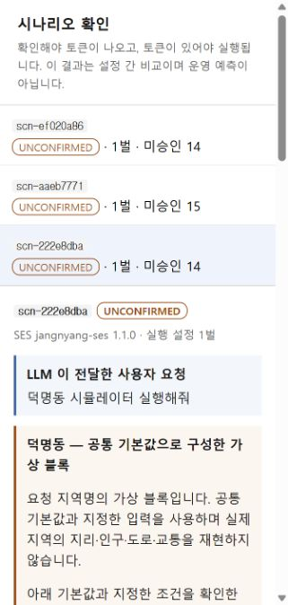

# 지역명 기반 가상 시나리오 일반화

2026-11-03. 사용자가 선택한 정책: 지역 데이터가 없으면 공통 기본값으로 가상 시나리오를 만들고 확인 후 실행한다.
제품 변경은 로컬 작업 트리에 있으며 커밋·푸시는 하지 않았다.

## 바뀐 동작

- 새 MCP 도구 create_neighborhood_scenario는 요청 원문과 지역명으로 RUN 목적의 설정 한 벌을 구성한다.
- 등록되지 않은 "덕명동", 처음 보는 지역명도 새 Java 코드나 지역별 카탈로그 항목 없이 공통 가상 블록을 만든다.
  지역을 지정하지 않으면 "가상 동네"를 사용한다. 지역명은 지오코딩하지 않은 사용자 라벨이다.
- 사용자 지정 값과 필수 조건을 먼저 반영하고, 등록 지역의 기본값, 공통 템플릿 기본값 순으로 나머지를 채운다.
  차종별 가용 적재량은 기존 planner.defaultFor에서 계산한다. 존재하지 않는 가지의 결정은 기본값으로 채우지 않는다.
- 범위를 벗어난 입력은 기본값으로 덮어쓰지 않는다. 기본값이 없는 결정이 필요하면 NEEDS_INPUT과 missingInputs를 반환한다.
- 능력 카드에 임의 지역명에 대한 가상 블록 정책을 선언했다. 브로커는 이를 CONDITIONAL로 반환하고
  selection과 새 생성 도구를 안내한다. 실제 지역 구성과 Task 검증을 통과해야 조건이 해소된다.
- 선택 이후에도 요구 지역·기간·필수 값·지표를 실제 실행 설정과 대조한다.
- 새 생성 도구는 UNCONFIRMED로 저장하고 confirmUrl을 제공한다. 사람이 승인한 뒤 기존 토큰 실행 경로를 사용한다.
  새 도구는 승인하거나 시뮬레이션을 실행하지 않는다.
- 확인 화면, 상태 응답, 실행 결과에 지역명·ASSUMED_BLOCK·가정 안내가 남는다.
- 다른 지역에 장량동 교통·지점 접근성·좌표나 포항 배출 시간대를 적용하지 않도록 차단하거나 분리했다.
- 기본 실행 경로와 기존 직접 실행 도구 설명에 새 지역 구성 흐름을 안내했다.

사용법: [지역명으로 가상 시나리오 구성](../../guides/NEIGHBORHOOD_SCENARIOS.md).

## 검증

| 대상 | 전체 | 통과 | 실패/오류 | 스킵 |
|---|---:|---:|---:|---:|
| broker | 156 | 156 | 0 | 0 |
| simulator | 701 | 698 | 0 | 3 |
| template-generator | 45 | 45 | 0 | 0 |
| parking-sim | 89 | 89 | 0 | 0 |
| counter-sim | 31 | 31 | 0 | 0 |
| district-waste-sim | 40 | 40 | 0 | 0 |
| 합계 | 1062 | 1059 | 0 | 3 |

루트 전체 clean install이 통과했고, 마지막 지역 기본값 우선 적용 변경은 NeighborhoodScenarioTest 8건을 다시 실행하여 검증·패키징했다.
독립 제공자 세 곳의 clean test도 통과했다. 실패 무시 옵션은 사용하지 않았다.
표는 루트 전체 검사와 마지막 집중 검사 후의 Surefire XML을 합산한 값이며, 같은 테스트의 반복 실행을 중복 집계하지 않았다.
스킵 3건은 기존 Python 참조 엔진 부재에 따른 조건부 중단이다. [test-summary.json](test-summary.json)에 집계를 보관했다.

신규/확장 회귀 검사:

- 서로 다른 미등록 지역명, 지역 미제시, 사용자 입력 없는 기본 구성.
- 등록 지역 기본값 우선 적용, 사용자 지정 값 보존, 잘못된 값에 대한 질문.
- 지역 조건부 매칭과 실제 구성 후 검증, 선택 당시 지역과 입력 불일치.
- 타 지역 교통·배출 정책·골목 진입 제한의 혼입 방지.
- 미승인 실행 거절, 메모리 내 승인 모사 후 실제 DEVS 실행, 실행 결과의 지역·가정 안내 보존.
- 지역 변경 및 실패한 수정 후 이전 검증/승인 무효화.

실제 로컬 브로커/시뮬레이터로 scripts/demo_neighborhood_flow.py의 9개 사례도 통과했다.
원문 응답은 [live-demo.json](live-demo.json)이다. 실제 서버에서 사용자 승인은 발급하지 않았다.
확인 화면을 브라우저로 열어 요청 원문·덕명동 라벨·가상 블록 안내·기본값 목록·UNCONFIRMED 상태를 확인했다.
확인 화면 JavaScript 구문 검사와 git diff --check도 통과했다.

## 범위

이번 일반화는 "장량동 실행 코드에 지역명을 고정"하는 제약을 풀고, 같은 폐기물 수거 모델로 임의 지역의 가정 기반 블록을 구성하는 기능이다.
실제 덕명동 인구·건물·도로망을 자동 취득하거나 재현한 것은 아니다.
현재 블록 모델의 건물 상한은 26개이며 동 전체 규모나 실제 도로 기반 예측을 지원한다고 주장하지 않는다.
자연어에서 지역·목적을 추출하는 일은 MCP 클라이언트 LLM이 담당한다. 그 해석 정확도를 이번 회귀 결과로 대신하지 않는다.
실제 지역 데이터 기반 실행은 제공자 데이터 어댑터와 공간 모델을 별도로 확장해야 한다.
