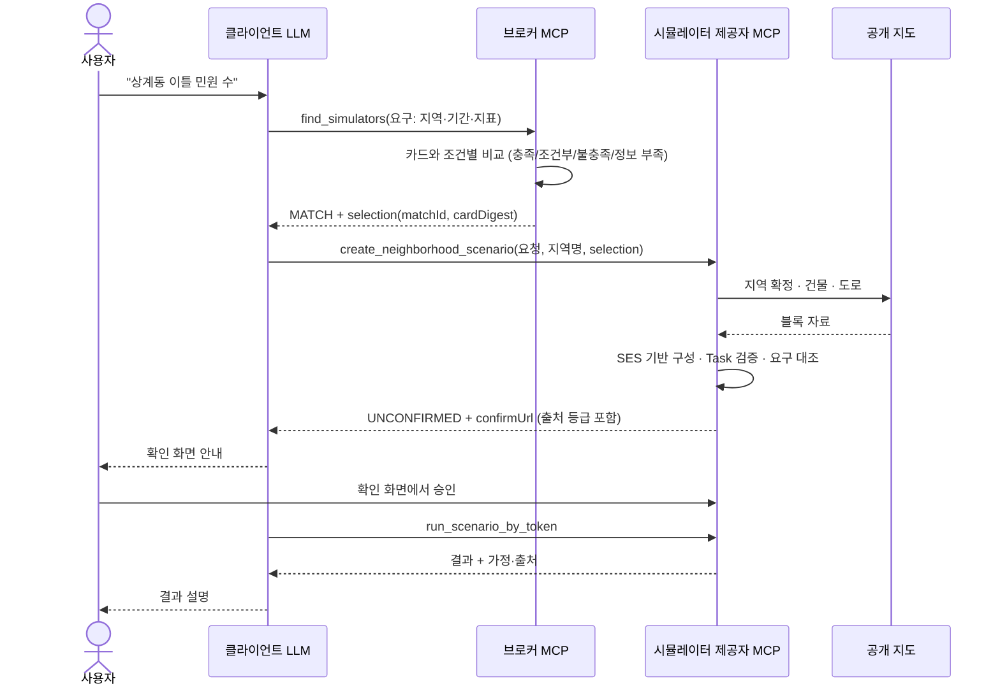

# 역할 분리와 MCP 서버 분리 근거

작성일: 2026-11-04. [해결 설계](../resolution-design-2026-11-03.md)의 R4다.
교수님 지적 7(연구 목표와 구현의 모순)과 8(브로커·시뮬레이터 서버를 나눈 이유)에 답한다.
아래 내용은 현재 코드와 실험 기록을 근거로 정리했다. 각 항목에 근거가 된 파일이나 보고서를 함께 적었다.

## 1. 모순의 정리

| 지적 | 답 |
|---|---|
| 연구 목표는 "사용자가 시뮬레이터 구조와 실행 방법을 몰라도 실행"인데, 구현은 미리 정의된 구조에 의존한다 | **"사용자가 몰라도 된다"는 "아무도 정의하지 않아도 된다"가 아니다.** 구조는 시뮬레이터 제공자가 한 번 정의하고, 사용자는 목적과 조건만 말한다. 둘 사이를 LLM·브로커·제공자 서버가 잇는다 |

이 연구가 자동화하는 것은 **사용자 쪽 지식**이다. 제공자 쪽 지식(모델 구조, 입력 의존, 검증 규칙, 데이터 출처)을 없애는 것이 아니다.
제공자 지식을 사람이 매번 전달하지 않아도 되도록 기계가 읽을 수 있는 명세로 만드는 것이 기여다.

## 2. 행위자별 역할

| 행위자 | 알아야 하는 것 | 미리 정의하는 것 | 판정하는 것 | 판정하지 않는 것 |
|---|---|---|---|---|
| **사용자** | 무엇을 알고 싶은지(도메인, 지역명, 기간, 보고 싶은 결과, 바꿔 볼 조건) | 없음 | 확인 화면에서 실행 승인, 질문에 대한 답 | 시뮬레이터 선택, 구조, 입력 의존, 기본값 |
| **클라이언트 LLM** | MCP 도구 설명 | 없음 | 발화를 구조화된 요구로 옮기기, 질문 문장 전달, 결과 설명 | 후보 적합성, 입력 유효성, 실행 허용 (서버가 판정) |
| **브로커 MCP 서버** | 등록된 능력 카드 | 공통 요구·능력 비교 규칙 | 조건별 충족 여부, 후보 선택·제외, 요청 조정 제안 | 상세 입력, 지역 데이터, 실행 가능 여부의 최종 확정 |
| **시뮬레이터 제공자** (MCP 서버 + 명세) | 자기 모델 | 능력 카드, SES, Task 명세, 지역 데이터 수집기, 검증 규칙, 엔진 | 구성 후 요구 충족 확정, 입력 준비 상태, 범위·근거 검증, 승인 토큰 확인 후 실행 | 다른 제공자와의 비교 |
| **시스템 개발자** | 공통 계약 | 요구·능력 계약 형식, 브로커 비교 규칙, SES 평가기·파생기 | — | 개별 시뮬레이터의 모델 내용 |

LLM은 판정을 맡지 않는다. 발화 해석이 틀리면 서버 판정(불충족·질문·거절)에서 걸리도록 했다.
LLM 해석 정확도와, LLM이 틀렸을 때 서버가 막는 비율은 R1에서 따로 잰다.

## 3. 제공자가 미리 정의하는 산출물

| 산출물 | 파일 | 누가 읽나 | 비고 |
|---|---|---|---|
| 능력 카드 | `simulator/src/main/resources/mcp/jangnyang-capability-card.json` | 브로커, LLM | `sesDigest`는 SES에서 파생 |
| SES | `simulator/src/main/resources/ses/jangnyang-ses.json` | 제공자 서버 | 결정·조건·범위·질문·설정 필드의 원본 |
| 서브태스크 템플릿 | `.../ses/jangnyang-templates.json` | 제공자 서버 | SES에서 파생. 직접 고치지 않음 |
| Task 명세 | `.../ses/task-manifest.json` | 제공자 서버 | 결정을 준비 단계로 묶음 |
| 지역 데이터 | `.../regions/catalog.json` + `OsmRegionResolver` | 제공자 서버 | 등록 지역 + 공개 지도 자동 수집 |
| 검증 규칙 | `SimulationConfigValidator`, `RegionCatalog.check` | 제공자 서버 | 범위·지역 제약 |
| 엔진 | `SimulationEngine` | 제공자 서버 | — |

새 시뮬레이터 제공자는 이 목록을 채우면 브로커와 LLM 쪽 코드를 고치지 않고 참여할 수 있다.
실제로 주차·민원 창구·구 단위 폐기물 제공자 세 곳이 같은 방식으로 참여한다(`../parking-sim`, `../counter-sim`, `../district-waste-sim`).

## 4. 자동 처리 · 질문 · 거절의 경계

결정마다 SES 에 역할(INTENT 의도 · DATA 데이터 · ASSUMPTION 가정)이 적혀 있고, 확인 화면은 "사용자가 정해야 하는데 기본값으로 채운 것"을
따로 보여 준다. 분류와 처리 방식 비교는 [결정 역할 보고서](../reports/decision-roles-2026-11-04/REPORT.md)에 있다.

사용자에게 묻지 않고 처리할지, 물을지, 막을지를 아래 표로 정했다. 모든 경우 실행 전에 사람의 승인을 받는다.

### 4.1 자동 처리 (확인 화면에 출처를 표시)

| 상황 | 처리 | 출처 표시 | 위치 |
|---|---|---|---|
| 사용자가 말하지 않은 결정에 템플릿 기본값이 있다 | 기본값으로 채움 | MODEL_DEFAULT, 승인 대상 목록 | `CreateNeighborhoodScenarioTool` |
| 지역 자료가 값을 정한다(건물 수·세대 수·수거장 용량·구간 이동시간) | 지역 자료로 채움 | REGION_DATA + 출처 등급(OBSERVED/ESTIMATED/ASSUMED) | `OsmRegionResolver`, `BuildScenarioTool` |
| 요구에서 값이 나온다(기간 2일 → days=2) | 요구 값으로 채움 | DERIVED | `CreateNeighborhoodScenarioTool` |
| 지도에서 지역을 못 찾거나 주거 건물이 부족하거나 지도 서버에 닿지 못함 | 공통 가상 블록으로 구성 | ASSUMED_BLOCK + 실패 사유 | `CreateNeighborhoodScenarioTool` |
| 생성 조건이 거짓인 결정 | 묻지 않고 만들지 않음 | 구조 선택 표에 "선택 안 됨" | `SubtaskPlanner` |

### 4.2 질문

| 상황 | 응답 | 위치 |
|---|---|---|
| 활성 결정에 값도 기본값도 없다 | NEEDS_INPUT + 질문 목록 | `SubtaskPlanner` |
| 같은 이름의 지역이 여러 곳 | NEEDS_REGION + 후보 목록 | `OsmRegionResolver` |
| 요구를 그대로 받는 후보가 여럿 | 브로커 CHOOSE + 후보 간 차이 | `FindSimulatorsTool` |
| 그대로 받는 후보가 없고 요구를 고치면 가능 | 브로커 ADJUST_REQUEST + 조정 제안 | `FindSimulatorsTool` |
| 카드가 선언하지 않아 판단할 수 없음 | AMBIGUOUS / UNKNOWN 항목 | `CandidateMatcher` |
| 조건부 결정의 기본값을 사용자가 동의했는지 발화에 근거가 없음 | 근거 미확인으로 표시, 확인 화면에서 승인 요구 | `EvidenceGuard` |

### 4.3 거절

| 상황 | 응답 | 위치 |
|---|---|---|
| 필수 조건을 만족하는 후보가 없음(선호 조건으로 상쇄 불가) | 브로커 NONE 또는 ADJUST_REQUEST | `RequirementContract` |
| 범위 밖 값, 허용되지 않은 선택지 | 입력 거절(기본값으로 덮지 않음) | `SubtaskPlanner`, `SimulationConfigValidator` |
| 선택되지 않은 가지의 결정에 값이 남아 있음 | 빼라고 거절 | `ScenarioBuilder` |
| 사용자 값이라며 낸 값이 발화와 맞지 않음 | GUARD 거절 | `EvidenceGuard` |
| 선택 당시 카드·요구와 실제 실행 설정이 다름 | 재매칭 요구 | `SelectionContract` |
| 다른 지역에 장량동 교통·포항 배출 조건 적용 | 지역 검증 실패 | `RegionCatalog.check` |
| 지역 자료가 바뀌었거나 변조됨 | 지역 식별값 불일치 | `RegionCatalog.check` |
| 승인 없이 실행, 승인 후 설정 변경 | 실행 거절, 이전 승인 무효 | `RunScenarioByTokenTool`, `ScenarioStore` |

### 4.4 사람만 하는 일

- **발화와 해석의 확인:** 사용자가 했다는 말(userUtterances)과 그 해석도 LLM 이 넘긴 것이라 서버는 진위를 모른다.
  확인 화면이 발화 · 읽어 낸 값 · 근거 구절 · 근거가 발화에 있는지를 나란히 보여 주고,
  사람이 "위 발화는 내가 한 말이고, 읽어 낸 값이 내 뜻과 맞다"를 체크해야 승인 버튼이 켜진다.
  확인 화면을 거치지 않은 승인 요청(`spokenAcknowledged` 없음)은 서버가 거절한다.

- **실행 승인:** 확인 화면에서 사람이 승인해야 토큰이 나온다. 생성 도구는 승인하거나 실행하지 않는다.
- **질문에 대한 답:** LLM이 대신 답을 지어내면 근거 검사(GUARD)에서 걸린다.

## 5. "사용자가 몰라도 된다"의 범위

| 사용자가 말하는 것 | 사용자가 몰라도 되는 것 | 사용자가 해야 하는 것 |
|---|---|---|
| 도메인("쓰레기 수거"), 지역명("상계동"), 기간("이틀"), 보고 싶은 결과("민원 수"), 바꿔 볼 조건(선택) | 어느 시뮬레이터 서버가 맞는지, SES 구조, 결정 사이의 의존, 설정 필드 이름, 기본값, 지역 데이터 출처와 추정 방법 | 확인 화면에서 기본값·가정을 보고 승인, 시스템이 묻는 질문(동명이인, 값이 필요한 결정)에 답 |

실제 사례: "상계동에서 이틀 동안 쓰레기 수거 시뮬레이터 돌려서 민원 수 보여줘"라는 요청이 아래 순서로 처리됐다([기록](../reports/region-resolution-2026-11-03/test-summary.md)).
1. 브로커가 생활폐기물 블록 제공자를 선택했다(지역 조건은 CONDITIONAL).
2. 제공자가 지도에서 서울 노원구 아파트 블록 26동을 찾아 구성했다.
3. 사용자가 확인 화면에서 승인했다.
4. 실행했다.

사용자는 건물 수, 세대 수, 수거장 용량, 이동 모델을 말하지 않았다.

## 6. 브로커와 시뮬레이터 서버를 나눈 이유

### 6.1 요구에서 설계로

| 요구 | 따라 나오는 설계 |
|---|---|
| R-a. 시뮬레이터 제공자가 여럿이고 각자 따로 배포·운영한다 (현재 4개, 포트 8090~8093, 각자 브로커에 등록) | 후보 비교를 어느 한 제공자 안에 둘 수 없다 → 제공자 밖의 **브로커** |
| R-b. 어떤 시뮬레이터를 쓸지 LLM이 감으로 고르면 안 되고, 근거가 남아야 한다 | 브로커가 카드와 요구를 **규칙으로 비교**하고 조건별 판정과 `matchId`를 남긴다 |
| R-c. 상세 입력·지역 데이터·엔진은 제공자 소유다 (교통 실측, 지도 수집, 모델 코드) | 브로커는 **카드만** 보고, 구성과 실행은 **제공자 서버**가 한다 |
| R-d. 카드만으로는 실행 가능 여부를 확정할 수 없는 조건이 있다 (예: 등록되지 않은 지역) | **두 단계 판정**: 브로커는 CONDITIONAL로 넘기고, 제공자가 구성한 뒤 CONFIGURATION_VERIFIED로 확정 |
| R-e. 브로커의 선택과 제공자의 실행이 서로 어긋나면 안 된다 | **선택 계약**(`matchId`, `cardDigest`, `requirements`)으로 둘을 잇는다. 카드가 바뀌거나 실행 설정이 요구와 다르면 막는다 |

### 6.2 다른 구조를 쓰면 생기는 문제

| 대안 | 문제 |
|---|---|
| 단일 서버에 모든 시뮬레이터를 넣는다 | 제공자가 독립적으로 배포·갱신할 수 없다. 새 제공자를 넣을 때마다 서버 코드를 고쳐야 한다 |
| LLM 클라이언트가 모든 제공자 서버에 직접 연결한다 | 도구 수가 제공자 수에 비례해 늘고(제공자마다 7개 안팎), 선택이 LLM 판단에 맡겨져 근거가 남지 않는다 |
| 브로커가 실행까지 중계한다 | 브로커가 제공자별 상세 입력·데이터·검증을 알아야 해서 결합이 커진다. 제공자 명세가 바뀔 때마다 브로커도 바뀐다 |

### 6.3 실험 근거

| 근거 | 결과 | 보고서 |
|---|---|---|
| 정답 구조화 요구 24개로 실제 브로커 선택 | 24/24 기대 후보 집합과 일치 | [model-evaluation](../reports/model-evaluation-2026-11-03/REPORT.md) |
| 여러 차례 요구를 조정하는 매칭 | 조정 단계별 선택 변화 기록 | [broker-multiround](../reports/broker-multiround-2026-11-02/REPORT.md) |
| 브로커 판정 실험 | 후보 선택·제외 기록 | [broker-experiment](../reports/broker-experiment-2026-10-19/REPORT.md) |
| 미등록 지역 두 단계 판정 | 브로커 CONDITIONAL → 제공자 CONFIGURATION_VERIFIED (망원동·상계동) | [region-resolution](../reports/region-resolution-2026-11-03/test-summary.md) |

## 7. 전체 흐름 (논문 그림 초안)

## 8. 남은 한계

- 브로커가 비교하는 카드 항목(지역·기간·해상도·지표·수치 조건)은 공통 계약에 정한 것만 다룬다. 계약에 없는 조건은 UNKNOWN으로 남는다.
- 제공자가 카드를 잘못 적으면 브로커는 그대로 믿는다. 구성 후 제공자 쪽 대조(요구 vs 실행 설정)가 일부를 잡지만, 엔진이 카드와 다르게 동작하는 경우는 잡지 못한다.
- 같은 폐기물 도메인의 실제 제공자는 둘(블록 단위 장량동 기반, 구 단위)이고 공간 규모로 갈린다. 같은 규모·같은 도메인에서 능력이 조금씩 다른 제공자 여럿을 두고 고르는 사례는 아직 없다.
- 근거 검사(GUARD)는 클라이언트가 사용자 발화 목록을 넘길 때만 동작한다. 넘기지 않으면 값의 출처를 검증하지 못하고 확인 화면의 승인에 맡긴다. 규칙은 공통 모듈 하나로 브로커 요구와 모든 제공자 입력에 같이 적용된다([안내](../guides/EVIDENCE_GUARD.md)).
